

<a href="https://clairineanr.github.io/">
  <picture>
    <source media="(prefers-color-scheme: dark)" srcset="./assets/profile-scan-dark.svg">
    <source media="(prefers-color-scheme: light)" srcset="./assets/profile-scan-light.svg">
    
  </picture>
</a>

  

  
  &nbsp;&nbsp;
  
  &nbsp;&nbsp;
  
  &nbsp;&nbsp;
  

---

### 💡 About Me
I'm an **Undergraduate Sains Data (Data Science) Student** at **Telkom University Surabaya**, passionate about transforming complex tabular, text, and unstructured data into actionable intelligence and predictive models. My focus revolves around **Applied Machine Learning**, **Natural Language Processing (NLP)**, and building end-to-end data pipelines.

---

### 📊 Telemetry & Activity Stats

  
  &nbsp;&nbsp;
  

---

### 🛠️ Technology Stack & Frameworks

| Area | Technologies & Frameworks |
| :--- | :--- |
| **Data Science & ML** | Python, Scikit-Learn, Pandas, NumPy, Statsmodels, Matplotlib, Seaborn |
| **Databases & Querying** | PostgreSQL, MySQL, Relational Database Modeling (DDL/DML) |
| **Software Engineering** | Java (OOP), PHP, Object-Oriented Design, Version Control (Git/GitHub) |
| **Mathematical Foundations**| Linear Algebra, Probability & Statistics, Multicollinearity Diagnostics |

---

### 🚀 Selected Repositories & Highlights

<table>
  <tr>
    <td width="50%" valign="top">
      <h4><a href="https://github.com/Clairineanr/mlp-vs-random-forest-breast-cancer">🎗️ MLP vs Random Forest Breast Cancer Classification</a></h4>
      
Benchmark study evaluating Multi-Layer Perceptron (Neural Network) against Random Forest on clinical diagnostic data with Hyperparameter Tuning (GridSearchCV).

      
<b>Highlights:</b> Achieved 97.4% test accuracy, comprehensive ROC-AUC evaluation, and confusion matrix diagnostics.

      
<code>Python</code> · <code>Scikit-Learn</code> · <code>Pandas</code> · <code>Machine Learning</code>

    </td>
    <td width="50%" valign="top">
      <h4><a href="https://github.com/Clairineanr/multiple-linear-regression-for-fuel-efficiency-analysis">🚗 Fuel Efficiency Regression Modeling</a></h4>
      
Econometric and statistical modeling of vehicle fuel efficiency (MPG) using Multiple Linear Regression with classical assumption diagnostics.

      
<b>Highlights:</b> Rigorous multicollinearity checking via VIF, residual normality validation, and feature significance testing.

      
<code>Python</code> · <code>Statsmodels</code> · <code>Data Analysis</code> · <code>EDA</code>

    </td>
  </tr>
  <tr>
    <td width="50%" valign="top">
      <h4><a href="https://github.com/Clairineanr/cic-music-player">🎵 CiC Music Player</a></h4>
      
Desktop audio player application engineered with Python, Tkinter GUI, and Pygame sound engine featuring playlist management and playback controls.

      
<b>Highlights:</b> Modular architecture, asset bundling, and Windows executable packaging.

      
<code>Python</code> · <code>Tkinter</code> · <code>Pygame</code> · <code>Desktop App</code>

    </td>
    <td width="50%" valign="top">
      <h4><a href="https://github.com/Clairineanr">📊 Sentiment Analysis Folkative (Naïve Bayes)</a></h4>
      
NLP sentiment classification on public social media discussions analyzing positive, neutral, and negative public sentiment distributions.

      
<b>Highlights:</b> Complete text preprocessing pipeline (stopword removal, stemming, TF-IDF vectorization).

      
<code>Python</code> · <code>NLP</code> · <code>Naïve Bayes</code> · <code>Text Mining</code>

    </td>
  </tr>
</table>

---

  <i>"Transforming data into insight, building intelligence with purpose."</i>

