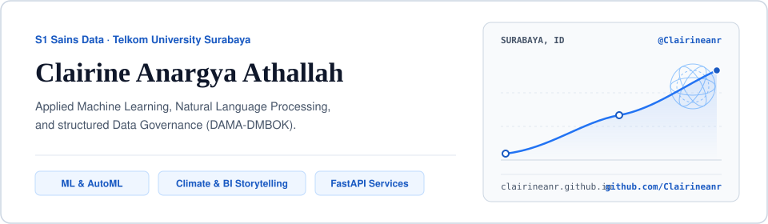



<a href="https://clairineanr.github.io/">
  <picture>
    <source media="(prefers-color-scheme: dark)" srcset="./assets/banner-dark.svg" />
    <source media="(prefers-color-scheme: light)" srcset="./assets/banner-light.svg" />
    
  </picture>
</a>

  

  <a href="https://clairineanr.github.io/" target="_blank">
    <picture>
      <source media="(prefers-color-scheme: dark)" srcset="./assets/btn-portfolio-dark.svg" />
      <source media="(prefers-color-scheme: light)" srcset="./assets/btn-portfolio-light.svg" />
      
    </picture>
  </a>
  &nbsp;
  <a href="https://www.linkedin.com/in/clairineanargya" target="_blank">
    <picture>
      <source media="(prefers-color-scheme: dark)" srcset="./assets/btn-linkedin-dark.svg" />
      <source media="(prefers-color-scheme: light)" srcset="./assets/btn-linkedin-light.svg" />
      
    </picture>
  </a>
  &nbsp;
  <a href="mailto:clairineanargya14@gmail.com">
    <picture>
      <source media="(prefers-color-scheme: dark)" srcset="./assets/btn-email-dark.svg" />
      <source media="(prefers-color-scheme: light)" srcset="./assets/btn-email-light.svg" />
      
    </picture>
  </a>
  &nbsp;
  <a href="https://github.com/Clairineanr?tab=repositories" target="_blank">
    <picture>
      <source media="(prefers-color-scheme: dark)" srcset="./assets/btn-repos-dark.svg" />
      <source media="(prefers-color-scheme: light)" srcset="./assets/btn-repos-light.svg" />
      
    </picture>
  </a>

Undergraduate Data Science student at Telkom University Surabaya (Class of 2024) focusing on applied machine learning, natural language processing, and data governance (DAMA-DMBOK). I build reproducible analytical notebooks, FastAPI inference services, and interactive data visualizations.

## Selected Work

| Project | Domain | Summary & Stack |
| :--- | :--- | :--- |
| [Born Below the Future Sea](https://github.com/Clairineanr/born-below-the-future-sea) ([Live](https://born-below-the-future-sea.vercel.app/)) | Climate Scrollytelling | Visualizes 31 years (1993-2024) of Pacific Island satellite altimetry data · `TypeScript`, `Vercel` |
| [Smart-Mustahik](https://github.com/Clairineanr/smart-mustahik) | Decision Support | Random Forest classifier on East Java BPS data (87.50% accuracy), SERI-FEST 2026 paper · `Python`, `Scikit-Learn`, `Pytest` |
| [FastAPI House Price Predictor](https://github.com/Clairineanr/fastapi-house-price-predictor) | ML Inference API | REST endpoint with Pydantic v2 schema validation and regression artifacts · `FastAPI`, `Pydantic`, `Pytest` |
| [MLP vs Random Forest](https://github.com/Clairineanr/mlp-vs-random-forest-breast-cancer) | Clinical Classification | Breast Cancer Wisconsin benchmark with SMOTE evaluation (97.08% accuracy) · `Python`, `Scikit-Learn`, `Pytest` |
| [Fuel Efficiency Regression](https://github.com/Clairineanr/multiple-linear-regression-for-fuel-efficiency-analysis) | Econometric Modeling | Auto MPG OLS regression (`R² = 0.818`) with VIF and residual diagnostics · `Python`, `Statsmodels`, `Pytest` |

## Stack & Credentials

- **ML & Analytics:** Python, Scikit-Learn, TensorFlow, AutoKeras, Pandas, NumPy, Statsmodels
- **Data & BI:** SQL (PostgreSQL, MySQL), PySpark, GeoPandas, Looker Studio, DAMA-DMBOK
- **Web & Engineering:** FastAPI, Pydantic v2, TypeScript, Pytest, Git, GitHub Pages
- **Papers & Certifications:** SERI-FEST 2026 KTIQ (IPB University), Gayatama 5 ISEC (UNESA), Huawei ICT Academy AI (2026), Inixindo Smart Data Governance (DAMA-DMBOK, 2026)
